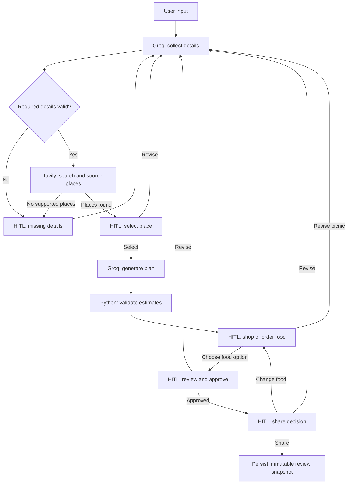

# BLANKET & BITES !! — Smart Picnic Planner

A conversational picnic planner using **FastAPI, LangGraph, Groq, Tavily, and Human-in-the-Loop (HITL)**. The chat page collects your details, and the separate Your picnic page displays researched places, the complete plan, finalization controls, and a group review link. No frontend build step is needed.

## Run locally

```sh
python3.13 -m venv .venv
source .venv/bin/activate
pip install -r requirements.txt
```

Add your private API keys to `.env` (already ignored by Git):

```dotenv
GROQ_API_KEY=your_private_groq_key
TAVILY_API_KEY=your_private_tavily_key
GROQ_MODEL=openai/gpt-oss-20b
```

The model is configurable; choose a currently supported Groq model with JSON object output if your account does not support the default. `.env.example` contains an empty configuration template. Keys load on server startup and stay on the backend. Restart after changing them.

```sh
uvicorn backend.main:app --reload --host 127.0.0.1 --port 8000
```

Open http://127.0.0.1:8000. API documentation: http://127.0.0.1:8000/docs.

## Host on Render

The repository includes a `render.yaml` Blueprint for one free Python web service.
FastAPI serves both the frontend and API. `.python-version` selects Python 3.13;
use Python 3.13 for local development too.

1. Push this branch to a GitHub repository you control.
2. Sign in to [Render](https://dashboard.render.com/), choose **New > Blueprint**,
   connect the repository, and select this branch.
3. Review the `blanket-and-bites` service and add `GROQ_API_KEY` and
   `TAVILY_API_KEY` as private environment variables. Optionally set `GROQ_MODEL`.
4. Deploy. Render installs `requirements.txt`, starts one Uvicorn worker on its
   assigned `$PORT`, and checks `/api/health`.
5. Open the HTTPS URL and verify `/api/health` reports `status: ok` and
   `mode: langgraph`. Then create a plan from the homepage.

The free Blueprint uses ephemeral storage. Workflow checkpoints, shared snapshots
and group feedback can be lost on restart or redeploy; browser saves cannot restore
lost server workflows. For durable hosting, configure persistent storage and set
`PICNIC_GRAPH_DB_PATH` and `PICNIC_DB_PATH` to files on that storage. See
[Render's free-service limits](https://render.com/docs/free).

## User flow

Describe your picnic, for example:

> Plan a team picnic for 30 people near San Ramon next Saturday with a $1,000 budget, vegetarian food and lawn games, within 20 miles.

1. **Groq understands the request.** It extracts details, resolves dates using the browser's local date, and preserves occasion and activity notes.
2. **HITL — missing details.** LangGraph pauses for missing budget, guest count, food option, location, date or travel distance. Answer in the chat. Python validates ranges and dates before research.
3. **Tavily researches places.** Search results are summarized into up to five distinct places with source URLs. The app may show fewer than five; no supported results prompts a revised location or distance.
4. **HITL — place selection.** Follow the chat handoff to **Your picnic** (`/picnic.html`) and choose a place from the cards. Return to **Picnic planner** to revise the search in chat.
5. **Groq generates the plan.** It suggests menu, schedule, shopping, coordination tasks and backup options using the selected venue and requirements.
6. **Python validates estimates.** It checks allowance totals and a minimum food allowance of $8 per guest. An insufficient food allowance blocks approval.
7. **HITL — food selection.** The **Plan your picnic food** page offers **Shop for ingredients** and **Order prepared food** tabs. Guest count, food allowance, dietary needs and venue stay visible. Select **Find** to research nearby groceries or restaurants using Tavily and Groq, near the venue or starting location. Save a grocery store and a restaurant independently using **Save grocery store** and **Save restaurant**, or mark either business for later. Both choices remain visible in the food lineup; selecting one does not replace the other. **Review picnic plan** opens **Your picnic** for final review after saving your choices. Purchases happen on the linked business website; the app does not place orders. The food allowance remains an estimate, not a quote. A plan with both sources keeps the ingredient shopping list and adds ordering and transport tasks. The two sources share the existing food allowance; it is not counted twice.
8. **HITL — final approval.** Food selection returns you to review. Review the plan, ask for revisions, or select **Save & finalize**. This finalizes the canonical server plan, saves it in this browser, and highlights **Share for review**. **Save draft** keeps an unfinished copy without finalizing it. Repeated finalized saves keep sharing enabled. Changing the food choice invalidates approval and requires another review. General revisions return through collection and place selection.
9. **HITL — sharing decision.** Only after approval does **Share for review** create an immutable server-side snapshot. Both food choices appear in saved and shared plan summaries. Already shared plans stay read only. **Edit food in a new version** makes an editable copy with the same picnic details, venue and menu, without rerunning providers or changing the original review link. Copy the link and send it through your own chat or email.

The left navigation separates **Picnic planner** (chat and detail collection), **Your picnic** (place selection, full plan, finalization and sharing), **Choose food options**, and **Saved plan**. The chat offers a handoff instead of showing the full plan beside the conversation. Conversation messages stay in this tab’s session storage by workflow so they survive navigation; the server remains the source of truth for picnic state.

The six-step guide shows which required details the server has collected: budget, guests, food, location, date, and distance. Choose a step to enter or update that detail, then select **Save and continue**. You can also supply several details together in chat. A step is marked complete only after the server confirms it.

**Edit details** sends structured corrections through the same graph. **Save & finalize** finalizes and stores one plan and its workflow reference in this browser. **Save draft** stores a copy without approval. **Saved plan** opens that saved copy in separate sections for overview, place, food, budget, schedule, shopping, assignments, and backup. **Open Your picnic** loads the server's current workflow, which may be newer than the saved copy; older sample plans remain viewable and exportable. Switching between the planner and saved copy preserves the active conversation. Export JSON downloads the displayed plan. **New picnic** starts a new thread. After sharing, start a new picnic for another plan; the completed snapshot stays unchanged.

## LangGraph implementation



`backend/workflow.py` defines a real `StateGraph`, conditional edges, `interrupt()` calls and `Command(resume=...)`. Each checkpoint persists to SQLite. The browser retains a random thread token and restores the current pause or result after refresh. A failed provider node can be retried without repeating completed graph nodes. Same-thread operations are serialized within this single-process app; use one Uvicorn worker for this local implementation.

Graph state includes validated picnic details, the pending question, researched venues, selected venue, generated plan and sharing status. Search results are reused when location, distance, guest count and notes are unchanged. Groq extracts supported places only from Tavily excerpts; source URLs must exactly match retrieved results. Unknown distance, capacity and fees stay unknown.

`backend/providers.py` handles bounded, timed server-side API calls, JSON validation, safe source links and readable errors for missing keys, rate limits and provider failures. There is no automatic fallback to invented venues or the old local parser when providers fail.

`POST /api/chat` starts or resumes a thread with `message`, `today`, `thread_id`, and an action (`message`, `select`, `food`, `approve`, `share`). `GET /api/workflows/{thread_id}` restores it. `POST /api/workflows/{thread_id}/food-options` searches food businesses with `mode` (`shop` or `order`) and `near` (`venue` or `start`). Food search results are cached for one hour per workflow, picnic context, mode and search area. The `food` action accepts the mode, area, search ID and option ID; business details are resolved from server results, not client-supplied business objects. Changed picnic details or expired searches require a fresh search. Approval and sharing use the server's checkpointed plan; the frontend cannot submit an edited plan to bypass approval.

`backend/conversation.py`, `POST /api/plans` and the original sample sharing endpoint remain for legacy sample compatibility and regression tests. The current chat interface uses the LangGraph endpoints instead.

## Estimates and research limits

Tavily performs web search, not map routing or reservation lookup. Suggested places are candidates near the requested area; exact travel distance, capacity, fees, hours and date-specific availability require direct verification. Official park sources are preferred but not guaranteed. LLM extraction and summaries can be mistaken, so review linked sources.

Budgets are transparent planning allowances calculated in Python: food 60%, supplies 12%, and venue allowance up to 10% capped at $100. They are not real quotes or known venue fees. Groq uses dietary and activity requirements when generating suggestions, but dietary safety and ingredient suitability are not verified. Weather and reservations are not integrated. No email, invitation or calendar event is sent automatically. Provider use is subject to your accounts' quotas and pricing.

## Sharing and persistence

Anyone with a review link can view its snapshot and feedback and respond without an account. Links are possession-based; responses are self-reported and unauthenticated. Snapshots exclude raw prompt, full guest-name list and private notes fields; generated plan content and coordination roles remain visible. Treat generated content as public once shared.

The backend stores:

- `data/workflow.sqlite3`: graph checkpoints, including private picnic details and notes. Override with `PICNIC_GRAPH_DB_PATH`.
- `data/picnics.sqlite3`: shared snapshots, group feedback and food-search results. Override with `PICNIC_DB_PATH`.

Keep these files on persistent storage. New picnic clears the browser's active reference but does not delete stored checkpoints. Workflow tokens permit access to and control of that workflow; keep them private. Group review tokens give read/feedback access only. This local project has no user accounts, checkpoint expiry or multi-user authentication.

A `127.0.0.1` link works only on your device. To share on Wi-Fi, bind the server to `0.0.0.0`, open it with your computer's LAN IP and create the link there. For remote groups, host behind HTTPS at a reachable address. This change does not deploy the app.

## Verification

```sh
python3 -m unittest discover -s tests -v
```

With Node.js installed, run the frontend display regression tests:

```sh
node --test tests/test_plan_ui.cjs tests/test_food_ui.cjs tests/test_planner_actions.cjs
```

Tests exercise the actual compiled graph with mocked providers: missing-detail interrupts, checkpoint restoration, selection, generation, approval gates, low-budget blocking, revisions, cached searches, provider retry, session isolation, canonical sharing, source validation and feedback privacy. Browser checks cover place cards, reload/resume, approval gating, share review and mobile layouts. Mocked checks use no provider credits; live testing requires configured keys.

`preview/index.html` contains captured UI screens. LangGraph fixture screenshots are explicitly labeled as using mocked provider data. Fonts use Google Fonts with system fallbacks.


# Flow and Detail
Component	Responsibility
Frontend	Chat, place choices, plan preview, approval, sharing and feedback
FastAPI	Receives requests, validates input and serves the app
LangGraph	Coordinates steps, pauses for human input and resumes workflows
Groq LLM	Extracts details, summarizes search results and generates the plan
Tavily	Searches the web for picnic places and source links
Python validation	Checks required details, date, limits and budget allowances
SQLite	Stores workflow checkpoints, shared plans and feedback

The required details are budget, guest count, food preference, starting location, date, and travel distance.

The BLANKET & BITES branding and locally served picnic photographs are retained from the feature branch. Photographs are AI-generated; see `frontend/images/ARTWORK.md`.
